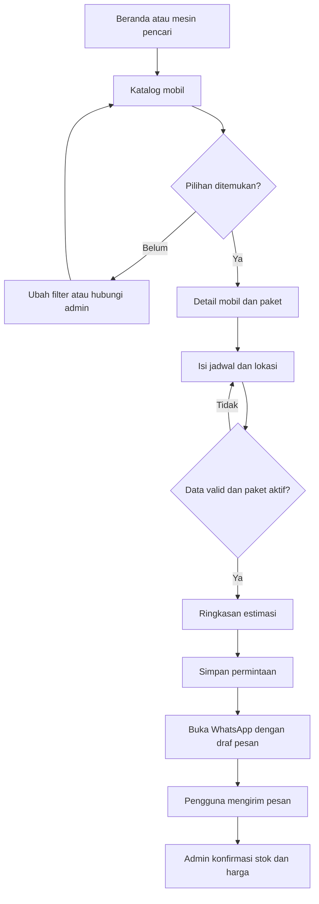
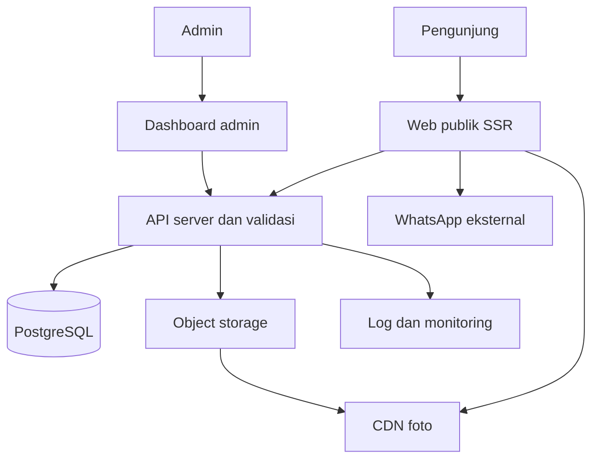

# PRD & Spesifikasi Produk — Website Rental Mobil

Versi 1.0 · 18 Oktober 2026 · Status: draft siap dipakai untuk diskusi desain dan implementasi.

## 1. Ringkasan produk

Website rental mobil yang membantu pengunjung menemukan kendaraan, memahami paket dan perkiraan biaya, lalu mengirim permintaan sewa melalui WhatsApp. Desain harus bersih, responsif, menarik, dan mengutamakan kemudahan memilih mobil di ponsel.

Website merupakan katalog dan penghasil permintaan sewa. Membuka WhatsApp tidak membuat reservasi, mengunci unit, membuktikan pesan terkirim, atau mengonfirmasi pembayaran. Admin menyelesaikan pemeriksaan ketersediaan, penawaran final, persyaratan, dan konfirmasi melalui WhatsApp.

### Keputusan awal dan asumsi

| Hal | Keputusan awal |
|---|---|
| Nama brand | `[NAMA BRAND]`, wajib diganti sebelum publikasi |
| Area layanan | Belum ditentukan; Bali hanya konteks referensi, bukan fakta bisnis pengguna |
| Bahasa dan mata uang | Indonesia, IDR; bahasa Inggris fase berikutnya |
| Pengunjung | Tidak perlu akun |
| Paket | Lepas kunci dan/atau dengan sopir, dapat diatur per mobil |
| Pemesanan | Permintaan melalui WhatsApp bisnis milik pengguna |
| Harga | Estimasi berbasis paket; final dikonfirmasi admin |
| Ketersediaan | Tidak menggunakan kalender stok real time di MVP |
| Zona waktu | Konfigurasi IANA per lokasi usaha; gunakan Asia/Makassar jika operasional di Bali |
| Entitas katalog | Model/penawaran mobil, bukan setiap unit dengan pelat nomor |

Asumsi bukan ketentuan operasional final. Area layanan, nomor WhatsApp, harga, paket, foto, dan kebijakan harus diisi pemilik bisnis sebelum peluncuran.

## 2. Tujuan, pengguna, dan metrik

Tujuan bisnis: meningkatkan permintaan sewa yang sudah memuat pilihan mobil dan kebutuhan dasar; memudahkan admin memperbarui katalog tanpa mengubah kode.

Persona utama:

- Wisatawan/pelanggan individu: ingin cepat memilih mobil sesuai anggaran dan tanggal.
- Keluarga/rombongan: membutuhkan kapasitas, bagasi, dan pilihan sopir yang jelas.
- Admin rental: mengelola penawaran, foto, harga, dan tindak lanjut permintaan.

| Metrik | Definisi |
|---|---|
| Rasio klik WhatsApp | Sesi yang menekan CTA WhatsApp / sesi katalog atau detail |
| Penyelesaian formulir | Permintaan tersimpan / formulir yang mulai diisi |
| Rasio permintaan valid | Permintaan yang dinilai relevan admin / permintaan tersimpan |
| Konversi operasional | Permintaan berstatus won / permintaan valid, diperbarui manual |
| Kualitas teknis | Pantau performa ponsel, error API, dan kegagalan membuka tautan |

Target konversi ditetapkan setelah baseline 2–4 minggu; jangan menjanjikan kenaikan sebelum ada data. Klik WhatsApp tidak boleh dilaporkan sebagai pesan terkirim atau transaksi berhasil.

## 3. Lingkup dan feature list

| ID | Prioritas | Fitur | Kriteria penerimaan inti |
|---|---|---|---|
| F01 | P0 | Beranda | Nilai utama, pilihan mobil, cara sewa, dan CTA terlihat jelas |
| F02 | P0 | Katalog | Cari nama, filter kategori/transmisi/kapasitas/paket, urut harga |
| F03 | P0 | Detail mobil | Galeri, spesifikasi, paket, harga per satuan, syarat dan CTA |
| F04 | P0 | Form permintaan | Pilih paket, tanggal/jam, lokasi dan lihat estimasi sebelum WhatsApp |
| F05 | P0 | WhatsApp handoff | Pesan sesuai pilihan; nomor berasal dari konfigurasi bisnis |
| F06 | P0 | Admin katalog | Login, tambah/edit/arsip mobil, foto, paket dan harga |
| F07 | P0 | Pengaturan bisnis | Brand, WA, area, jam operasional, FAQ, syarat dan privasi |
| F08 | P0 | Daftar permintaan | Referensi, snapshot estimasi, filter status, catatan admin |
| F09 | P0 | SEO dan aksesibilitas | Metadata, URL detail, navigasi keyboard, label dan alt foto |
| F10 | P0 | Analytics dasar | Event funnel tanpa nama, nomor pelanggan atau isi pesan |
| F11 | P1 | Favorit lokal | Simpan pilihan pada perangkat tanpa login |
| F12 | P1 | Bahasa Inggris | Konten dan pesan WA terlokalisasi |
| F13 | P1 | Testimoni terverifikasi | Hanya konten nyata yang telah diizinkan |
| F14 | P2 | Kalender unit dan transaksi | Dirancang terpisah setelah kebutuhan operasional jelas |

Di luar MVP: akun pelanggan, pembayaran online, booking otomatis, integrasi WhatsApp Business API, pengiriman pesan otomatis, pelacakan kendaraan, dan multi-vendor. Tidak perlu keranjang belanja karena satu permintaan berfokus pada satu mobil/paket.

## 4. User stories

1. Sebagai pengunjung, saya bisa menyaring mobil berdasarkan kebutuhan agar tidak membuka semua detail.
2. Sebagai calon penyewa, saya melihat perbedaan paket dan komponen biaya agar tidak menganggap semua harga sudah termasuk sopir/BBM.
3. Sebagai calon penyewa, saya mengisi jadwal dan lokasi lalu melanjutkan ke WhatsApp tanpa membuat akun.
4. Sebagai admin, saya bisa menonaktifkan paket tanpa menghapus riwayat permintaan.
5. Sebagai admin, saya bisa meninjau permintaan dan memperbarui hasil tindak lanjut secara manual.

## 5. Sitemap dan hak akses

| URL | Halaman | Akses |
|---|---|---|
| `/` | Beranda | Publik |
| `/mobil` | Katalog dengan filter di query string | Publik |
| `/mobil/[slug]` | Detail dan form permintaan | Publik |
| `/cara-sewa` | Langkah dan persyaratan sewa | Publik |
| `/syarat-ketentuan` | Ketentuan bisnis yang disetujui pemilik | Publik |
| `/faq` | Pertanyaan umum | Publik |
| `/tentang` | Identitas usaha dan area layanan | Publik |
| `/kontak` | Kontak dan jam layanan | Publik |
| `/kebijakan-privasi` | Penggunaan data dan pihak eksternal | Publik |
| `/admin/login` | Login admin | Publik, dibatasi percobaan |
| `/admin` | Ringkasan permintaan | Admin |
| `/admin/mobil` | CRUD katalog dan paket | Admin |
| `/admin/permintaan` | Daftar dan detail permintaan | Admin |
| `/admin/konten` | FAQ dan halaman informasi | Admin |
| `/admin/pengaturan` | Konfigurasi bisnis | Admin |

Permintaan tidak memiliki halaman publik berisi data pelanggan. Halaman admin tidak diindeks; keamanan tetap melalui autentikasi dan otorisasi server.

## 6. User flow



### Perilaku detail

- CTA kartu: “Lihat mobil”; halaman detail: “Lanjut ke WhatsApp”. Floating WhatsApp hanya kontak umum dan tidak wajib mengisi form.
- Input wajib untuk permintaan terstruktur: paket, waktu mulai, waktu selesai, lokasi penjemputan. Nama dan catatan opsional; jangan meminta KTP/SIM pada website MVP.
- Form membawa pilihan paket dan rentang waktu dari katalog jika sudah dipilih. Kembali ke katalog mempertahankan filter.
- Filter tanggal tidak mengklaim mengecek stok. Tulis “Tanggal kebutuhan”, bukan “Mobil tersedia”.
- Jika WA gagal dibuka, tampilkan nomor, tombol salin pesan, dan tautan coba lagi. Jangan menampilkan “Booking berhasil”.
- Jika penyimpanan gagal: pertahankan input, beri retry; izinkan kontak WA langsung dengan label “Permintaan belum tersimpan” dan tanpa referensi palsu.
- Jika harga berubah sebelum submit: server mengembalikan konflik dengan estimasi terbaru; pengguna meninjau kembali sebelum lanjut.
- Link detail mobil tidak aktif menampilkan halaman informatif dan alternatif; slug tidak dikenal menghasilkan 404.

### Alur admin

Login → katalog → tambah draft → isi data/foto/paket → pratinjau → publikasikan. Permintaan baru → contacted → won atau lost; spam merupakan status terpisah. Status adalah catatan manual, bukan hasil pembacaan WhatsApp. Setiap transisi menyimpan aktor dan waktu.

## 7. UI/UX dan kewajiban UI/UX Max

**Instruksi wajib bagi AI/desainer penerima PRD:** temukan dan baca skill UI/UX Max yang terpasang sebelum mengerjakan desain. Gunakan nama/path persis yang tersedia; jangan mengarang nama command atau mengklaim telah menjalankannya jika tidak tersedia. Jika tidak ditemukan, jelaskan keterbatasannya dan minta lokasi skill sebelum tahap desain final. Penyusunan spesifikasi dan wireframe awal tetap dapat berjalan.

Pada sesi penyusunan dokumen ini, skill bernama UI/UX Max belum ditemukan. Bagian berikut merupakan brief desain untuk diterapkan menggunakan skill tersebut, bukan keluaran yang diklaim berasal darinya.

### Tahap pemilihan tema

AI wajib menawarkan **tepat 3 rekomendasi tema** sebelum implementasi visual final. Masing-masing harus menyertakan alasan kesesuaian, palet, tipografi, gaya foto, komponen kartu/CTA, serta preview beranda dan detail pada desktop dan ponsel. Gunakan mobil, konten, dan susunan informasi yang sama agar bisa dibandingkan. Setelah itu pengguna memilih tema; jangan langsung menerapkan pilihan AI sebagai keputusan pengguna.

Tiga arah awal berikut boleh disempurnakan oleh UI/UX Max:

| Tema | Karakter dan audiens | Palet awal | Tipografi | Arah visual |
|---|---|---|---|---|
| A. Coastal Clean — rekomendasi awal | Ramah, tepercaya; cocok untuk rental wisata dan keluarga | BG `#F8FAFC`, surface `#FFFFFF`, teks `#0F172A`, primary `#0F766E`, aksen `#F59E0B` | Plus Jakarta Sans + Inter | Ruang lega, foto mobil terang, kartu sederhana, sudut 16px |
| B. Urban Executive | Rapi dan premium; cocok untuk perjalanan bisnis dan kendaraan kelas atas | BG `#F5F5F4`, surface `#FFFFFF`, teks/primary `#18181B`, aksen `#A16207` | Manrope + Inter | Tipografi kuat, gambar besar, garis tipis, sudut 10px |
| C. Friendly Explorer | Enerjik dan mudah didekati; cocok untuk wisatawan muda dan keluarga | BG `#FFFDF8`, surface `#FFFFFF`, teks `#172554`, primary `#1D4ED8`, aksen `#EA580C` | DM Sans + Inter | Kartu hangat, ikon jelas, sudut 20px, ilustrasi hanya sebagai aksen |

Warna di atas adalah arah, bukan bukti kelulusan kontras. Uji kombinasi teks, CTA, focus, disabled dan hover sebelum final. Gunakan hijau WhatsApp sebagai identitas kanal; CTA utama dapat memakai warna brand dengan ikon WhatsApp yang jelas.

### Design system dan responsivitas

- Mobile first; viewport QA 360, 390, 768, 1024, dan 1440px; tetap usable di 320px tanpa scroll horizontal.
- Kontainer maksimum 1200px; margin ponsel 16px, tablet 24px, desktop 32px.
- Grid katalog: 1 kolom di ponsel, 2 tablet, 3 desktop. Jangan mengecilkan kartu sampai informasi harga sulit dibaca.
- Skala spasi 4/8/12/16/24/32/48/64; body minimal 16px; line-height sekitar 1.5.
- Target interaksi minimal 44×44px; focus keyboard terlihat; label selalu tampil di luar placeholder.
- Harga, unit durasi, paket, dan syarat utama harus berdekatan. Jangan mengandalkan warna saja untuk status.
- Ponsel: sticky bottom CTA di detail, dengan ruang aman dan padding konten agar tidak tertutup. Floating chat tidak boleh menimpa CTA.
- Katalog ponsel: filter bottom sheet dengan tombol “Terapkan”, “Reset”, jumlah filter aktif, dan focus trap yang benar.
- Animasi singkat dan fungsional; hormati reduced motion; hindari carousel otomatis.
- Komponen: navbar, breadcrumbs, car card, gallery, chips, filter sheet, package selector, date/time inputs, cost breakdown, CTA, toast, alert, empty state, skeleton dan pagination.
- Setiap komponen utama punya default, hover/focus, loading, disabled, empty, error dan success yang relevan.

### Susunan layar

Beranda: navbar → hero singkat “Pilih mobil, lanjutkan sewa lewat WhatsApp” → pilihan paket/katalog → mobil unggulan → cara sewa 3 langkah → keunggulan yang dapat dibuktikan → FAQ → kontak/footer. Tampilkan testimoni hanya jika ada sumber nyata.

Katalog: judul → pencarian/filter → jumlah hasil/urutan → kartu → pagination. Kartu berisi foto, nama, transmisi, kapasitas terverifikasi, label paket, harga dan satuan durasi, CTA detail.

Detail desktop: galeri dan informasi di kiri, panel permintaan di kanan; mobile: galeri → nama/spesifikasi → paket/harga → form → syarat/FAQ → alternatif. Jangan menaruh harga penting setelah paragraf panjang.

Microcopy wajib: “Ketersediaan dan harga final dikonfirmasi admin melalui WhatsApp.” Jika biaya tambahan belum diketahui: “Belum termasuk biaya antar, parkir, tol, dan tambahan lain sesuai paket.” Sesuaikan rincian dengan kebijakan bisnis nyata.

## 8. Aturan bisnis dan perhitungan

1. Setiap mobil dapat memiliki beberapa paket aktif; paket tidak tersedia tidak ditampilkan sebagai harga nol.
2. Paket menyimpan unit durasi dalam menit: contoh lepas kunci 1440 menit, sopir 600 menit. Label “per hari” harus menjelaskan 24 jam jika aturan bisnis demikian.
3. MVP mengusulkan pembulatan ke atas: `unit = ceil((end_at - start_at) / duration_minutes)`; estimasi dasar `unit × unit_price_idr`. Tarif overtime khusus belum didukung dan harus dijelaskan jika bisnis menggunakannya.
4. Untuk paket 10 jam, pemakaian 12 jam diperkirakan 2 unit menurut aturan ini. Pemilik wajib menyetujui aturan sebelum peluncuran; jika tidak sesuai, gunakan label “Minta penawaran” untuk durasi tersebut sampai aturan diperbarui.
5. `start_at` harus setelah waktu sekarang dan `end_at > start_at`; minimal sewa mengikuti `min_units`. Konversi waktu menggunakan zona operasional, lalu simpan UTC.
6. Batas maksimum estimasi otomatis diusulkan 30 hari; kebutuhan lebih lama diarahkan meminta penawaran, bukan ditolak sebagai tidak dapat disewa.
7. Filter harga dan urut harga memakai paket terpilih. Tanpa paket, gunakan harga terendah aktif dengan label “Mulai dari” beserta unitnya; jangan membandingkan 10 jam dan 24 jam tanpa label.
8. Biaya antar yang belum diketahui disimpan sebagai belum dihitung, bukan Rp0. Estimasi total hanya menjumlah biaya yang telah ditentukan.
9. Tidak ada klaim “tersedia untuk tanggal ini”; `published` berarti penawaran tampil di katalog, bukan unit tersedia.
10. Simpan snapshot nama mobil, nama paket, durasi, tarif, unit dan estimasi saat permintaan dibuat agar perubahan katalog tidak mengubah riwayat.

## 9. System architecture

Rancangan awal: satu aplikasi web dengan SSR untuk halaman publik, admin terautentikasi, API server, PostgreSQL, dan object storage/CDN untuk foto. Pilihan implementasi: Next.js + TypeScript, komponen aksesibel, PostgreSQL dan ORM migrasi. Ini rekomendasi arsitektur, bukan kewajiban versi framework tertentu; versi dipilih dan diverifikasi saat implementasi.



Server menghitung estimasi dan membentuk tautan WA dari data tervalidasi; klien hanya menampilkan. Kredensial database, kunci storage dan sesi tidak masuk bundle publik. WhatsApp tidak mengakses database dan tidak memberi callback pesan terkirim pada MVP.

Lingkungan development, staging dan production terpisah. Admin memakai penyedia autentikasi tepercaya dengan sesi cookie HttpOnly/Secure dan otorisasi server; tidak perlu membuat sistem password sendiri jika layanan auth sudah tersedia. Backup harian dan uji pemulihan sebelum rilis.

## 10. Database schema

Semua ID internal UUID, uang integer IDR, waktu `timestamptz`. `created_at` dan `updated_at` tersedia pada tabel mutable. Harga dan snapshot tidak memakai float.

| Tabel | Kolom utama dan constraint |
|---|---|
| `admin_profiles` | `id UUID PK` merujuk identitas auth, `display_name`, `role` enum owner/admin, `active bool` |
| `categories` | `id PK`, `name`, `slug UNIQUE`, `sort_order` |
| `cars` | `id PK`, `category_id FK`, `slug UNIQUE`, `brand`, `model`, `display_name`, `description`, `transmission` manual/automatic, `passenger_capacity int CHECK >0`, `luggage_note`, `status` draft/published/archived, `featured bool`, `seo_title`, `seo_description` |
| `car_images` | `id PK`, `car_id FK`, `storage_key UNIQUE`, `alt_text`, `sort_order`, `source_url nullable`, `license_note`, `width`, `height`; foto pertama menjadi cover |
| `rental_packages` | `id PK`, `car_id FK`, `code`, `name`, `service_type` self_drive/with_driver, `duration_minutes CHECK >0`, `unit_price_idr bigint CHECK >0`, `min_units CHECK >=1`, `includes jsonb`, `excludes jsonb`, `terms_text`, `active bool`, `price_version int`; UNIQUE(car_id, code) |
| `inquiries` | `id PK`, `reference UNIQUE` acak tidak berurutan, `car_id FK`, `package_id FK`, `start_at`, `end_at CHECK > start_at`, `pickup_location`, `customer_name nullable`, `notes nullable`, `quote_snapshot jsonb`, `status` new/contacted/won/lost/spam, `idempotency_key UNIQUE`, `request_hash`, `privacy_notice_version`, `created_at`, `updated_at` |
| `inquiry_status_history` | `id PK`, `inquiry_id FK`, `from_status`, `to_status`, `actor_admin_id FK`, `note`, `created_at` |
| `business_settings` | Satu baris `id CHECK =1`, `brand_name`, `whatsapp_number_e164`, `service_timezone`, `service_areas jsonb`, `opening_hours jsonb`, `contact_email`, `address`, `published bool` |
| `content_pages` | `id PK`, `slug UNIQUE`, `title`, `body`, `published bool`, `version int` |
| `faqs` | `id PK`, `question`, `answer`, `sort_order`, `published bool` |
| `audit_logs` | `id PK`, `actor_admin_id FK`, `entity_type`, `entity_id`, `action`, `changed_fields jsonb`, `created_at`; jangan log isi data pribadi secara berlebihan |

Relasi: category 1:N cars; car 1:N images dan packages; car/package 1:N inquiries; inquiry 1:N status history. Car/package yang pernah dipakai tidak dihapus fisik; arsip/nonaktifkan. Hapus foto melalui proses storage yang konsisten; jangan biarkan objek yatim.

Index: cars(status, category_id), cars(featured), packages(car_id, active), inquiries(status, created_at DESC), status_history(inquiry_id, created_at). Cari nama case-insensitive; full-text/search service baru ditambahkan jika data dan kebutuhan membenarkan.

Validasi aplikasi dan transaksi memastikan paket milik car yang dikirim. Akses inquiry hanya admin; tidak ada endpoint daftar inquiry publik. Kebijakan retensi awal: hapus/anonymize data pribadi inquiry setelah 180 hari, kecuali kebutuhan usaha yang disetujui; periode final diputuskan pemilik. Terapkan juga pada backup sesuai siklus retensinya.

## 11. API specification v1

Base path `/api/v1`. JSON UTF-8, uang integer IDR; waktu ISO 8601 dengan offset. Endpoint publik hanya mengembalikan data terbit. Semua write admin membutuhkan autentikasi, otorisasi dan proteksi CSRF sesuai mekanisme sesi.

| Method dan endpoint | Akses | Fungsi |
|---|---|---|
| GET `/cars` | Publik | Katalog; query `q,category,transmission,min_capacity,service_type,min_price,max_price,sort,page,limit` |
| GET `/cars/{slug}` | Publik | Detail, foto dan paket aktif |
| GET `/categories` | Publik | Kategori terbit |
| GET `/business` | Publik | Konfigurasi kontak publik; tanpa pengaturan rahasia |
| GET `/pages/{slug}` dan `/faqs` | Publik | Konten terbit |
| POST `/quotes` | Publik | Validasi pilihan dan kalkulasi estimasi; tidak menyimpan data pelanggan |
| POST `/inquiries` | Publik, rate limited | Simpan permintaan dan berikan draf/URL WhatsApp |
| GET `/admin/inquiries` | Admin | Pagination dan filter status/waktu |
| GET `/admin/inquiries/{id}` | Admin | Detail permintaan dan riwayat |
| PATCH `/admin/inquiries/{id}/status` | Admin | Status dan catatan manual |
| GET/POST `/admin/cars` | Admin | Daftar termasuk draft / tambah |
| PATCH `/admin/cars/{id}` | Admin | Edit dan arsip dengan status |
| POST `/admin/cars/{id}/packages` | Admin | Tambah paket |
| PATCH `/admin/packages/{id}` | Admin | Edit/nonaktifkan, increment price_version |
| POST `/admin/uploads` | Admin | Unggah gambar tervalidasi, batas awal 5MB JPEG/PNG/WebP |
| POST `/admin/cars/{id}/images` | Admin | Kaitkan objek unggahan yang sah ke mobil |
| PATCH/DELETE `/admin/images/{id}` | Admin | Urut/alt atau hapus foto |
| GET/PATCH `/admin/business` | Admin; nomor WA owner | Pengaturan usaha |
| GET/POST `/admin/pages` dan `/admin/faqs` | Admin | Daftar/tambah konten |
| PATCH `/admin/pages/{id}` dan `/admin/faqs/{id}` | Admin | Edit/publikasi konten |

GET katalog: `limit` default 12, maksimum 48; page minimal 1; sort enum recommended/price_asc/price_desc. Response `{data:[...],meta:{page,limit,total,total_pages}}`. Filter tak valid menghasilkan 422; tidak ada hasil menghasilkan 200 dengan array kosong. Slug tak terbit 404.

Contoh POST `/quotes` — UUID berikut hanya contoh:

```json
{
  "car_id": "11111111-1111-4111-8111-111111111111",
  "package_id": "22222222-2222-4222-8222-222222222222",
  "start_at": "2026-11-01T09:00:00+08:00",
  "end_at": "2026-11-03T09:00:00+08:00"
}
```

```json
{
  "data": {
    "currency": "IDR",
    "unit_price_idr": 300000,
    "duration_minutes": 1440,
    "units": 2,
    "base_estimate_idr": 600000,
    "additional_fees_status": "not_calculated",
    "price_version": 1,
    "availability": "requires_confirmation",
    "is_final_price": false
  }
}
```

POST `/inquiries`: header `Idempotency-Key` berupa UUID buatan klien. Body memuat empat field jadwal/pilihan di atas, ditambah `expected_price_version`, `pickup_location` (maks. 300 karakter), `customer_name` opsional (maks. 100), `notes` opsional (maks. 1000), dan `privacy_notice_version`. Jangan menerima harga total dari klien sebagai nilai otoritatif.

Response 201: `{data:{reference,quote_snapshot,whatsapp_url,whatsapp_message}}`. Request identik dengan key yang sama mengembalikan hasil yang sama dan tidak membuat duplikat; key sama dengan payload berbeda menghasilkan 409. Transaksi memvalidasi price_version, status publik mobil, dan paket aktif sebelum menyimpan snapshot. Price version tidak cocok menghasilkan 409 `PRICE_CHANGED` beserta quote baru, tanpa membuat inquiry.

Format error seragam:

```json
{
  "error": {
    "code": "VALIDATION_ERROR",
    "message": "Periksa waktu pengembalian.",
    "fields": {"end_at": "Harus setelah waktu mulai."},
    "request_id": "req_example"
  }
}
```

Status lain: 401 belum login; 403 akses ditolak; 404 tidak ditemukan; 409 konflik; 422 data tidak valid; 429 batas permintaan dengan Retry-After; 500 error umum tanpa stack trace. Rate limit awal POST publik 10 request/menit/IP, dievaluasi dengan trafik nyata; jangan menyimpan IP mentah permanen hanya untuk analytics.

### Kontrak WhatsApp

Tautan dibentuk sebagai `https://wa.me/{nomor_digit_internasional}?text={encodeURIComponent(pesan)}`. Nomor produksi berasal dari pemilik usaha, bukan nomor pada website referensi. Validasi konfigurasi saat startup/publikasi dan batasi tujuan ke wa.me; jangan menerima redirect URL arbitrer dari klien. Tautan membuka draf; pengguna tetap menekan kirim di WhatsApp.

Template:

```text
Halo [NAMA BRAND], saya ingin menanyakan sewa mobil.
Referensi: [KODE]
Mobil: [NAMA MOBIL]
Paket: [PAKET DAN DURASI]
Mulai: [WAKTU LOKAL + ZONA]
Selesai: [WAKTU LOKAL + ZONA]
Penjemputan: [LOKASI]
Estimasi dasar: [IDR] untuk [JUMLAH UNIT]
Biaya tambahan: belum dikonfirmasi
Mohon konfirmasi ketersediaan, persyaratan, dan harga final.
```

Batasi panjang input dan pesan; jangan memuat dokumen identitas atau data sensitif di query URL. Pada respons sukses tampilkan tautan yang benar-benar dapat diketuk; jangan bergantung pada popup async yang bisa diblokir browser. Kontak umum menggunakan pesan pendek tanpa membuat inquiry fiktif.

## 12. Konten referensi dan aset

Referensi diperiksa 18 Oktober 2026:

- https://balirental.id/ — pola katalog mobil, paket, CTA WhatsApp, dan konten kepercayaan.
- https://balirental.id/syarat-dan-ketentuan/ — contoh perlunya menjelaskan durasi dan batas paket; ketentuan mereka tidak otomatis menjadi ketentuan bisnis ini.
- https://balirental.id/tata-cara-penyewaaan/ — contoh pemesanan dan konfirmasi melalui komunikasi langsung.

Contoh data harga dari halaman katalog, hanya untuk mockup bertanda **DEMO**, bukan harga bisnis pengguna:

| Mobil | Paket lepas kunci | Paket sopir + BBM |
|---|---|---|
| Avanza Matic | Rp300.000/hari | Rp550.000/10 jam |
| Innova Reborn Matic | Rp500.000/hari | Rp850.000/10 jam |
| Brio Matic | Rp275.000/hari | Rp500.000/10 jam |

Kapasitas, tahun, varian dan bagasi harus diverifikasi dari armada pemilik; jangan menyalin kapasitas referensi sebagai fakta kendaraan. Gunakan placeholder jika belum terverifikasi. Harga sumber juga dapat berubah dan memiliki ketentuan minimum sewa.

Foto dari referensi boleh dijadikan acuan visual; penggunaan file fotonya perlu izin/lisensi. MVP desain boleh memakai foto sendiri, aset berlisensi, atau placeholder netral. Sebelum produksi wajib ada sumber dan hak pakai setiap foto. Jangan hotlink aset referensi, menyalin logo, identitas bisnis, nomor telepon, rekening atau testimoni mereka. Dokumen ini tidak menyertakan salinan foto dan tidak mengklaim telah memeriksa detail visual foto.

## 13. Kebutuhan nonfungsional dan keamanan

- Performa: sasaran LCP ≤2,5 detik, INP ≤200ms, CLS ≤0,1 pada persentil 75 setelah trafik cukup; sebelum rilis gunakan pengujian lab ponsel sebagai indikator, bukan klaim data lapangan.
- Gambar responsif, ukuran eksplisit untuk mencegah layout shift, lazy-load foto di bawah layar; foto utama diprioritaskan. Gunakan WebP/AVIF bila pipeline mendukung.
- Tidak ada overflow horizontal, form usable dengan keyboard layar, layout stabil saat loading/error.
- Aksesibilitas target WCAG 2.2 AA: contrast, keyboard, semantic headings, label, pesan error terhubung ke field, dialog focus management dan reduced motion.
- SEO: metadata unik, canonical URL, sitemap.xml, robots.txt, SSR detail mobil; halaman admin dan kombinasi filter tidak diindeks tanpa strategi khusus.
- Proteksi: validasi server, query terparameterisasi, sanitasi konten, pembatasan upload/MIME/signature, nama file acak, storage tidak mengeksekusi file, otorisasi tiap endpoint dan pencatatan audit.
- Privasi: pemberitahuan sebelum lanjut WhatsApp, data minimum, akses hanya admin; jangan log isi URL WA dan pesan pelanggan. Review ketentuan/privasi final sebelum produksi.
- Observability: catat request_id, latency dan kode error tanpa body pribadi; alarm untuk kegagalan create inquiry dan error server berulang.
- Analytics: `view_car`, `filter_applied`, `inquiry_started`, `inquiry_created`, `whatsapp_click`; hanya ID katalog dan properti nonpribadi. Consent analytics disesuaikan dengan penerapan dan wilayah usaha.

## 14. Acceptance criteria dan skenario QA

| Skenario | Hasil yang diharapkan |
|---|---|
| Buka situs pada 360px dan 1440px | Katalog, form, navigasi dan CTA terbaca tanpa overflow |
| Filter tidak menemukan mobil | Empty state, reset filter dan kontak admin |
| Mobil tanpa paket sopir | Paket tidak dapat dipilih; tidak muncul Rp0 |
| Mulai 1 Nov 09.00, selesai 3 Nov 09.00; paket 24 jam Rp300rb | 2 unit; estimasi dasar Rp600rb; biaya tambahan belum dihitung |
| Durasi 24 jam 1 menit | 2 unit menurut aturan pembulatan yang diberitahukan |
| Waktu selesai sebelum mulai | Validasi klien dan server; inquiry tidak dibuat |
| Paket bukan milik mobil | 422; tidak ada inquiry |
| Harga berubah saat form terbuka | 409 dan tinjau estimasi baru sebelum submit |
| Double click/retry jaringan | Satu inquiry untuk idempotency key yang sama |
| Paket dinonaktifkan sebelum submit | Ditolak jelas dan pilihan pengguna tetap tersimpan |
| WhatsApp tidak terbuka | Nomor dan salin pesan tersedia; tidak ada klaim pesan terkirim |
| Pengunjung meminta API admin | 401/403; data pribadi tidak bocor |
| Navigasi keyboard dan screen reader | Urutan focus benar; label dan error dapat dipahami |
| Upload file palsu/terlalu besar | Ditolak; tidak dapat dieksekusi atau dipublikasikan |
| Tarif katalog diedit setelah inquiry | Snapshot inquiry lama tidak berubah |
| Database gagal saat submit | Input tetap ada, retry dan kontak langsung tersedia |

## 15. Tahapan pengerjaan dan definition of done

1. **Validasi bisnis:** tentukan brand, wilayah, WA, paket, durasi, biaya tambahan dan kebijakan. Pastikan foto dan data armada sah.
2. **Eksplorasi UI/UX Max:** baca skill → tawarkan 3 tema setara → pemilik memilih → detailkan design tokens dan komponen.
3. **Desain:** wireframe beranda/katalog/detail/form/admin, mockup desktop dan ponsel, prototype klik menuju WA, serta state error/kosong/loading.
4. **Implementasi MVP:** schema/migrasi, admin, katalog, kalkulasi, inquiry dan handoff WA.
5. **QA dan peluncuran:** uji acceptance criteria, aksesibilitas, performa, backup/restore, nomor WA, konten dan analytics.

Definition of done: seluruh P0 berfungsi; tidak ada blocker pada alur utama; harga dan unit konsisten di kartu/detail/WA; tidak ada identitas bisnis referensi yang terbawa; data demo tidak tampil sebagai armada produksi; pemilik menyetujui konten operasional; admin bisa mengubah katalog; error monitoring dan backup aktif.

## 16. Prompt siap pakai untuk AI desain/pengembang

> Gunakan dokumen PRD ini sebagai sumber kebutuhan website rental mobil. Website berfokus pada katalog → pilih mobil/paket → isi jadwal/lokasi → tinjau estimasi → lanjut ke WhatsApp. Tidak ada checkout atau booking otomatis dalam MVP.
>
> WAJIB temukan dan baca skill UI/UX Max yang terpasang sebelum desain. Ikuti workflow aslinya dan sebutkan skill/path yang dipakai. Jika tidak tersedia, sampaikan apa adanya dan minta lokasi skill sebelum desain final; jangan mengklaim telah memakainya.
>
> Tahap pertama: tampilkan asumsi bisnis yang belum diputuskan dan berikan tepat 3 rekomendasi tema yang paling cocok. Untuk setiap tema berikan alasan, warna HEX, typography, layout, komponen, serta preview beranda dan detail mobil di desktop dan ponsel. Gunakan konten yang sama. Tema awal dalam PRD dapat disempurnakan dengan UI/UX Max. Rekomendasikan satu opsi, lalu tunggu saya memilih sebelum implementasi visual final.
>
> Setelah tema dipilih, buat design system, sitemap, user flow, wireframe, mockup dan prototype responsif lengkap dengan state loading, kosong, error dan fallback WhatsApp. Pertahankan kalimat bahwa harga final dan ketersediaan dikonfirmasi admin. Jangan menampilkan stok real time atau menganggap klik WA berarti pesan terkirim.
>
> Saat implementasi, ikuti kontrak data/API, server-side pricing, snapshot inquiry, idempotency dan keamanan admin pada PRD. Gunakan placeholder untuk brand, area layanan, nomor WA dan data yang belum diberikan. Foto sendiri/berlisensi diutamakan; balirental.id hanya referensi struktur dan contoh data demo, bukan identitas bisnis yang boleh disalin. Hasil akhir harus memenuhi kriteria penerimaan dokumen ini.

## 17. Keputusan yang masih perlu pemilik isi

- Nama brand, logo, area layanan, alamat dan nomor WhatsApp produksi.
- Armada aktual, kapasitas, foto, tarif, minimum sewa dan paket yang ditawarkan.
- Aturan durasi/overtime, pengantaran, biaya tambahan, pembatalan dan konfirmasi reservasi.
- Pilihan tema setelah menerima tiga preview dari AI desain.
- Penanggung jawab admin, kebijakan retensi, hosting/domain, dan kebutuhan bahasa Inggris.

Hal tersebut tidak menghalangi penggunaan PRD sebagai brief; tetap menjadi syarat sebelum peluncuran produksi.
